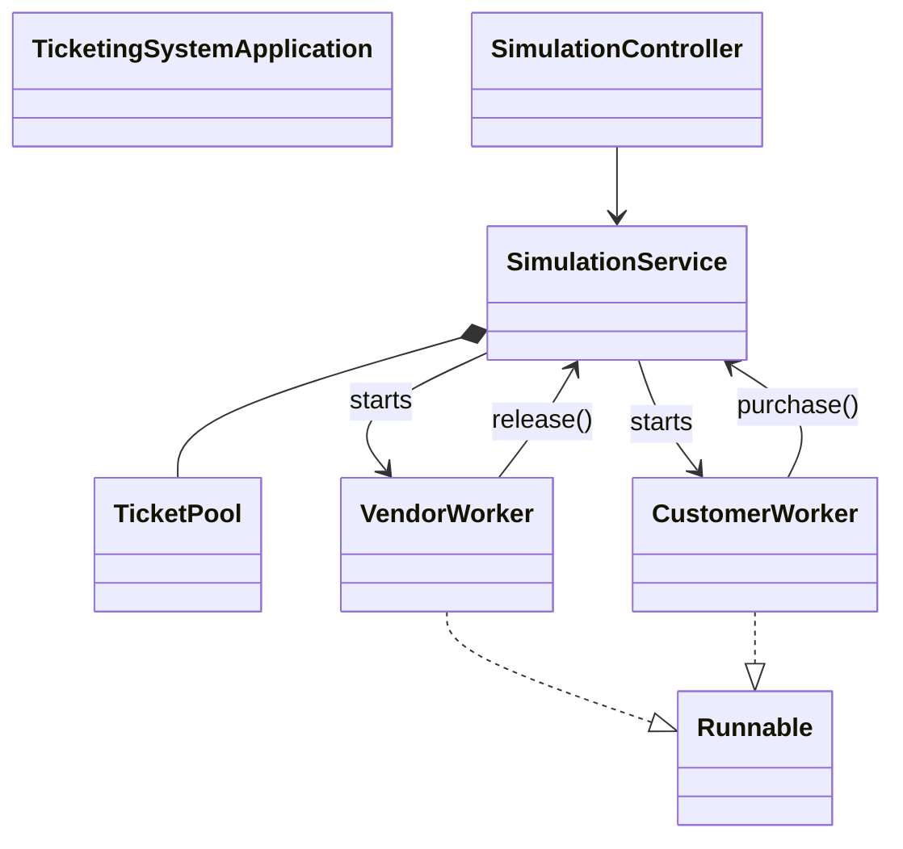

# Architecture — The Hot Seat

The `service` monitor serializes lifecycle, release, purchase and snapshot operations. `TicketPool` also synchronizes queue access and enforces maximum available capacity. Vendors release at intervals; customers purchase at intervals. The service enforces the total release target. A generation token prevents stale workers changing a new run. Stop requests interrupt workers but do not synchronously wait for their termination.

`entity` contains the shared ticket state, `worker` contains producer/consumer Runnable implementations, `service` owns the simulation, `controller` exposes HTTP endpoints, `springboot` starts the server, and `cli` provides an alternate console interface.

The `reference-only/legacy-cli` folder is archival source, excluded from the Maven build; it is not part of the live simulation.
